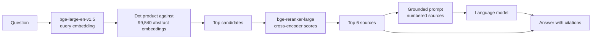
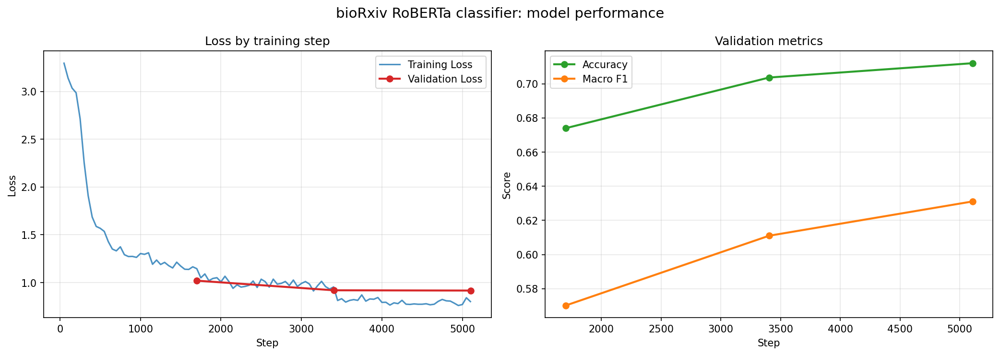
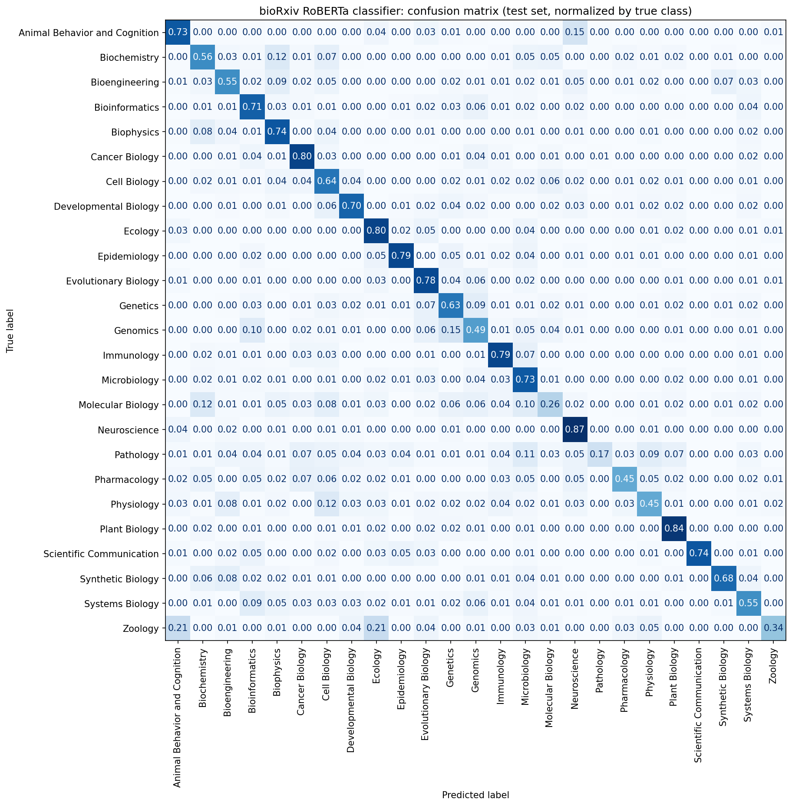
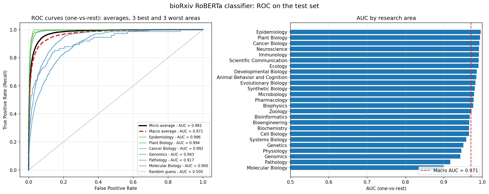

# Epidemic Question Answering with Biomedical RAG

Ask a question about the biomedical literature and get an answer that cites the preprints it was built from.

This repository holds a retrieval-augmented generation (RAG) pipeline over **99,540 bioRxiv preprint abstracts** and a **RoBERTa classifier** that predicts the research area of a preprint. Both were built in a Colab notebook and are served here with **Streamlit**, versioned and monitored with **MLflow**, and packaged with **Docker Compose**.


## Contents

- [Why this project](#why-this-project)
- [What is in the box](#what-is-in-the-box)
- [How a question is answered](#how-a-question-is-answered)
- [Results](#results)
- [Quick start with Docker](#quick-start-with-docker)
- [Using the app](#using-the-app)
- [Answer generator](#answer-generator)
- [Configuration](#configuration)
- [MLflow: registry, metrics and traces](#mlflow-registry-metrics-and-traces)
- [Performance on a laptop](#performance-on-a-laptop)
- [Command line](#command-line)
- [Tests](#tests)
- [Project structure](#project-structure)
- [Differences from the notebook](#differences-from-the-notebook)
- [Limitations](#limitations)
- [Troubleshooting](#troubleshooting)
- [Data, models and license](#data-models-and-license)

## Why this project

During a public health crisis such as the COVID-19 pandemic, thousands of papers are published every week. Searching them by hand is slow and needs domain expertise, and a generic search engine cannot guarantee that an answer is grounded in a trusted source.

The goal is a question answering system that retrieves the most relevant scientific documents and writes a clear answer in which **every claim points back to its source**.

## What is in the box

| Component | What it does | Model |
| --- | --- | --- |
| Dense retriever | Embeds the question and finds the closest abstracts | `BAAI/bge-large-en-v1.5` |
| Reranker | Rescores the candidates with a cross-encoder | `BAAI/bge-reranker-large` |
| Generator | Writes the answer from the top sources, with citations `[1]`, `[2]` | `Qwen/Qwen2.5-14B-Instruct` in the notebook, an API or a local model in the deployment |
| Area classifier | Predicts one of 25 bioRxiv research areas from title and abstract | `deepset/roberta-large-squad2`, fine-tuned |

The corpus is general bioRxiv, not an epidemic-only collection: about 2,900 of the 99,540 abstracts mention COVID-19, SARS-CoV-2 or coronavirus, and 1,245 are filed under Epidemiology. The epidemic scenario is the motivation; the system answers questions on any topic the corpus covers.

## How a question is answered



1. The question gets the bge instruction prefix and is embedded (CLS pooling, L2 normalization).
2. It is compared with the precomputed embeddings of every abstract.
3. The best candidates are rescored by the cross-encoder, which reads the question and each abstract together.
4. The top sources go into a prompt that tells the model to answer **only** from them, cite them inline and say so when they are not enough.

The deployment is three containers built from one image:

```mermaid
flowchart LR
    subgraph Docker Compose
        M[mlflow<br/>tracking server + model registry]
        G[register<br/>one-shot job]
        S[app<br/>Streamlit]
    end
    O[(output/<br/>files saved by the notebook)] -->|read once| G
    G -->|logs params, metrics,<br/>models and artifacts| M
    M -->|models:/biorxiv-rag@champion| S
    S -->|one trace per question| M
    U[Browser] --> S
    U --> M
    S -->|chat completions| LLM[LLM API<br/>or local model]
```

## Results

All numbers in this section come from the outputs of [`notebook/Transformer_RoBERta.ipynb`](notebook/Transformer_RoBERta.ipynb). The deployment does not recompute them; it logs them to MLflow as the record of the notebook run.

### Research-area classifier

Test set of 14,893 preprints, 25 areas.

| Metric | Value |
| --- | --- |
| Accuracy | 0.703 |
| Macro F1 | 0.624 |
| Weighted F1 | 0.702 |
| Top-3 accuracy | 0.922 |
| ROC AUC, one-vs-rest macro | 0.971 |
| ROC AUC, one-vs-rest micro | 0.981 |
| Majority-class baseline accuracy | 0.183 |

The classifier is strongest on Neuroscience (F1 0.899) and weakest on Pathology (F1 0.250, 75 test articles) and Molecular Biology (F1 0.322). Areas that overlap by nature, such as Genomics, Genetics and Bioinformatics, are confused with each other, which is why top-3 accuracy is so much higher than top-1.

Training setup: 3 epochs, batch size 32, learning rate 1e-5, weight decay 0.01, 510 warmup steps, bf16, title and abstract tokenized as a text pair with `max_length=384`, at most 4,000 training articles per area.

| Training curves | Confusion matrix |
| --- | --- |
|  |  |



### Retrieval

300 article titles were used as queries; a hit means the article's own abstract came back in the top k.

| k | Recall@k, dense retrieval | Recall@k, after reranking |
| --- | --- | --- |
| 1 | 0.747 | 0.703 |
| 5 | 0.970 | 0.977 |
| 10 | 0.990 | 0.997 |

Recall@1 is held down by the corpus itself: one preprint in five has several versions in the collection, so a different version of the right paper often takes first place.

### Example

> **Question:** What brain regions are involved in spatial navigation?

| # | Rerank score | Area | DOI |
| --- | --- | --- | --- |
| 1 | 5.48 | Neuroscience | [10.1101/2020.02.05.935379](https://doi.org/10.1101/2020.02.05.935379) |
| 2 | 2.97 | Neuroscience | [10.1101/2021.08.18.456677](https://doi.org/10.1101/2021.08.18.456677) |
| 3 | 2.91 | Neuroscience | [10.1101/150177](https://doi.org/10.1101/150177) |
| 4 | 2.90 | Neuroscience | [10.1101/377408](https://doi.org/10.1101/377408) |
| 5 | 2.86 | Neuroscience | [10.1101/2020.03.03.973131](https://doi.org/10.1101/2020.03.03.973131) |
| 6 | 2.69 | Neuroscience | [10.1101/473090](https://doi.org/10.1101/473090) |

The answer written by Qwen2.5-14B in the notebook names the hippocampus, the subicular complex, the retrosplenial cortex, the parahippocampal cortex and the somatosensory cortex, each with its citation. The full text is in [`output/rag_answers.csv`](output/rag_answers.csv).

**The deployed pipeline reproduces the notebook.** With the notebook settings (100 candidates, 6 sources, every version kept), the containerized CPU pipeline returns the same six sources in the same order, with the same scores, for both questions the notebook answered.

## Quick start with Docker

### Requirements

- Docker Desktop with the WSL 2 backend, or Docker Engine with the Compose plugin
- About 8 GB of memory available to Docker and 10 GB of free disk
- The files saved by the notebook, in `output/`

### 1. Put the saved files in `output/`

The notebook saves them to Google Drive under `biorxiv_classifier/`. Copy them into this layout:

```text
output/
├── rag_config.json                      pipeline settings
├── articles_full_v2.parquet             the corpus, 93 MB
├── bge_large_abstract_embeddings.pt     abstract embeddings, 204 MB
├── embedder/                            bge-large-en-v1.5, 670 MB
├── reranker/                            bge-reranker-large, 1.1 GB
└── roberta_classifier_v2/best/          fine-tuned classifier, 1.4 GB
```

These files are too large for git and are listed in `.gitignore`. Checkpoints and optimizer states can stay in the folder; they are not used.

### 2. Create `.env`

```bash
cp .env.example .env
```

Set `HF_TOKEN` if you want written answers through Hugging Face Inference Providers. Without a generator the app still retrieves and reranks, and shows the sources. See [Answer generator](#answer-generator).

### 3. Start

```bash
docker compose up -d --build
```

| Service | URL |
| --- | --- |
| Streamlit app | http://localhost:8501 |
| MLflow | http://localhost:5000 |

What happens on the first start, with times measured on a 12th-gen Core i5 laptop:

| Step | Time |
| --- | --- |
| Image build | about 6.5 minutes |
| `register` copies the models into the MLflow registry | about 5.5 minutes |
| The app loads the models when the page is first opened | 1 to 2.5 minutes |

Later starts skip the build and the copy: `register` compares a fingerprint of the files with the registered version and exits when nothing changed.

### 4. Stop

```bash
docker compose down
```

The registry, the MLflow database and the traces live in named volumes and survive `down`. Add `-v` to delete them.

### GPU

`docker-compose.gpu.yml` builds the app with a CUDA build of PyTorch and runs the retriever and the reranker on an NVIDIA GPU in half precision:

```bash
docker compose -f docker-compose.yml -f docker-compose.gpu.yml up -d --build
```

On Windows this needs Docker Desktop with the WSL 2 backend and a current NVIDIA driver. The classifier stays on the CPU so that a 4 GB card is enough for retrieval.

## Using the app

**Ask the literature.** Type a question in English. The app shows the search progress, streams the answer, and lists the sources with their rerank score, research area, DOI link and abstract. The sidebar controls the research area filter, how many abstracts are reranked, how many sources reach the model, and the answer length. Thumbs up or down is saved to MLflow as feedback on that question.

**Classify an article.** Paste a title and an abstract to get the five most likely research areas with their probabilities.

**About.** The pipeline configuration, the registered model version, and the results reported by the notebook.

## Answer generator

Qwen2.5-14B needs about 30 GB of GPU memory, so the deployment does not load it. `LLM_BACKEND` chooses what writes the answer:

| `LLM_BACKEND` | Generator | Needs |
| --- | --- | --- |
| `auto` (default) | `openai` if `LLM_BASE_URL` is set, else `hf_api` if `HF_TOKEN` is set, else `none` | |
| `hf_api` | Hugging Face Inference Providers. Tries the notebook model `Qwen/Qwen2.5-14B-Instruct`, then `Qwen/Qwen2.5-72B-Instruct`, then `Qwen/Qwen2.5-7B-Instruct` | `HF_TOKEN` and inference credits |
| `openai` | Any OpenAI-compatible chat completions endpoint: Ollama, vLLM, LM Studio or a hosted API | `LLM_BASE_URL`, `LLM_MODEL`, and `LLM_API_KEY` if the server asks for one |
| `local` | A causal language model loaded with transformers inside the app container. Default `Qwen/Qwen2.5-0.5B-Instruct` | Extra memory, and minutes per answer on CPU |
| `none` | No generation: the app shows the reranked sources only | |

Things to know:

- **A free Hugging Face account does not include inference credits.** Calls return `402 Payment Required` until credits are added or the account is upgraded at https://huggingface.co/settings/billing. A fine-grained token also needs the permission *Make calls to Inference Providers*.
- When the generator fails, the app says why and still shows the sources. A question never ends in an error page.
- Answers are generated with temperature 0, which matches `do_sample=False` in the notebook.

Example for Ollama running on the host:

```bash
LLM_BACKEND=openai
LLM_BASE_URL=http://host.docker.internal:11434/v1
LLM_MODEL=qwen2.5:7b
```

## Configuration

Docker Compose reads these from `.env`.

| Variable | Default | Meaning |
| --- | --- | --- |
| `HF_TOKEN` | empty | Hugging Face token for the `hf_api` generator |
| `LLM_BACKEND` | `auto` | `auto`, `hf_api`, `openai`, `local` or `none` |
| `LLM_MODEL` | empty | Model id. Empty uses the notebook model with fallbacks |
| `LLM_PROVIDER` | `auto` | Inference provider for `hf_api` |
| `LLM_BASE_URL` | empty | Base URL of an OpenAI-compatible server |
| `LLM_API_KEY` | empty | Key for that server |
| `DEVICE` | `auto` | `auto`, `cpu` or `cuda` for the retriever and the reranker |
| `RAG_N_RETRIEVE` | 100 on GPU, 40 on CPU | Abstracts reranked per question |
| `RAG_N_CONTEXT` | 6 | Sources given to the model |
| `RAG_MAX_NEW_TOKENS` | 400 | Answer length |
| `MLFLOW_TRACE_QUERIES` | `true` | Log one MLflow trace per question |
| `APP_PORT` | 8501 | Host port of the app |
| `MLFLOW_PORT` | 5000 | Host port of MLflow |

Only the generator settings are passed from `.env` to the app container. Other keys in the file, such as Kaggle credentials, stay on the host.

## MLflow: registry, metrics and traces

Open http://localhost:5000.

**Experiment `biorxiv-rag`** holds the two runs created by `scripts/register_models.py`:

| Run | Parameters and metrics | Artifacts |
| --- | --- | --- |
| `rag-pipeline` | Model names, prefix, lengths, `n_retrieve`, `n_context`; Recall@1/5/10 before and after reranking | `rag_config.json`, the notebook answers |
| `roberta-area-classifier` | Training hyperparameters; test metrics; the training loss and the validation curves per step | The three figures, the test predictions |

Every run is tagged `metrics_origin: copied from the notebook outputs, not re-executed`.

**Model registry.** Each run logs an MLflow `pyfunc` model that contains its weights, so a registered version is self-contained:

| Registered model | Input | Output |
| --- | --- | --- |
| `biorxiv-rag` | `question` | `answer`, `sources` as JSON |
| `biorxiv-area-classifier` | `title`, `abstract` | `area`, `probability`, `top_areas` as JSON |

The app loads `models:/biorxiv-rag@champion` and `models:/biorxiv-area-classifier@champion`. To serve another version, move the alias in the MLflow UI and restart the app.

Register again after retraining or replacing files in `output/`:

```bash
docker compose run --rm register
```

Add `python scripts/register_models.py --force` to create a new version even when the files did not change.

The models can also be used from Python, without the app:

```python
import mlflow
import pandas as pd

mlflow.set_tracking_uri("http://localhost:5000")
model = mlflow.pyfunc.load_model("models:/biorxiv-rag@champion")
result = model.predict(
    pd.DataFrame({"question": ["How does antibiotic resistance spread between bacteria?"]}),
    params={"n_retrieve": 40, "n_context": 6, "generate": False},
)
```

**Experiment `biorxiv-rag-serving`** receives one trace per question asked in the app, with a span for dense retrieval, one for reranking with the sources it selected, and one for generation with the prompt and the model that answered. The thumbs up or down from the app is attached to the trace as the `helpful` assessment.

## Performance on a laptop

Measured in Docker on a Core i5-12500H with 16 GB of RAM, CPU only, float32.

| | Measured |
| --- | --- |
| Memory used by the app with retriever, reranker and corpus loaded | 5.0 GB |
| Model loading | 1 to 2.5 minutes |
| Dense retrieval over 99,540 abstracts | about 3 seconds |
| Reranking 40 abstracts | about 40 seconds |
| Reranking 100 abstracts, the notebook setting | about 110 to 120 seconds |

Reranking is the bottleneck on CPU: the cross-encoder reads every candidate at up to 512 tokens. That is why the app reranks 40 abstracts by default on CPU and 100 on GPU. Lower *Abstracts reranked* in the sidebar for faster answers.

## Command line

`main.py` asks one question from the terminal. Inside the running stack:

```bash
docker compose exec app python main.py "How does antibiotic resistance spread between bacteria?" --n-retrieve 20
```

This loads a second copy of the models, so stop the app first if memory is short, or use `docker compose run --rm app python main.py ...`.

| Option | Meaning |
| --- | --- |
| `--area Epidemiology` | Search one research area |
| `--n-retrieve 100` | Abstracts reranked |
| `--n-context 6` | Sources given to the model |
| `--keep-versions` | Keep every version of the same preprint, as the notebook does |
| `--no-answer` | Print the sources only |

## Tests

The unit tests replace the models with fixed scores, so they run in seconds and need no GPU and no saved files. They cover the corpus filter and its alignment checks, version deduplication, the area filter, the prompt format, generator selection and model fallback.

```bash
docker compose run --rm --no-deps -v "./tests:/app/tests:ro" app sh -c "pip install -q pytest && python -m pytest -q tests"
```

## Project structure

```text
├── app/
│   └── streamlit_app.py         Streamlit app: ask, classify, about
├── src/biorxiv_rag/
│   ├── config.py                settings from environment variables
│   ├── corpus.py                corpus filter and embedding alignment checks
│   ├── pipeline.py              retrieval, reranking, prompt
│   ├── llm.py                   answer generators and fallback
│   ├── classifier.py            research-area classifier
│   ├── serving.py               loading from the MLflow registry or from output/
│   ├── mlflow_model.py          MLflow pyfunc wrappers
│   ├── tracking.py              one MLflow trace per question
│   └── notebook_results.py      numbers reported by the notebook
├── mlflow_models/               "models from code" entry points for MLflow
├── scripts/
│   └── register_models.py       logs runs and registers both models
├── tests/                       unit tests
├── docker/Dockerfile            one image for the three services
├── docker-compose.yml           mlflow, register, app
├── docker-compose.gpu.yml       GPU override for the app
├── notebook/
│   └── Transformer_RoBERta.ipynb  data preparation, training, evaluation, RAG
├── py/data_pre.py               parallel XML parser used by the notebook
├── img/                         figures produced by the notebook
├── output/                      files saved by the notebook, not in git
├── main.py                      command line
├── requirements.txt
└── .env.example
```

## Differences from the notebook

The deployment keeps the notebook's models, prompt and parameters. It changes four things, on purpose:

| Change | Why |
| --- | --- |
| Several versions of one preprint count as one source | 20,581 of the 99,540 rows repeat the DOI of another row. Without this, the same paper can fill several of the six source slots. Turn it off with *One version per preprint* in the app or `--keep-versions` on the command line |
| The area filter ignores spelling variants | The raw data has `Neuroscience` and `NEUROSCIENCE`, `Clinical Trials` and `Clinical_Trials` |
| The leading `Abstract` label is removed from the text shown and from the prompt | 87,482 abstracts start with it. The reranker still reads the original text, which is the text that was embedded |
| The reranker works in batches of 16 | The notebook scored 100 pairs in one batch on a 96 GB GPU |

The generator is the fifth difference, covered in [Answer generator](#answer-generator).

## Limitations

- **The classifier metrics are optimistic.** The split was made by row, and the dataset holds several versions of the same preprint. 3,428 of the 14,893 test rows (23%) share a DOI with a training row. On the other 11,465 rows, accuracy is 0.681 and macro F1 is 0.581, against 0.703 and 0.624 on the full test set. These two numbers were computed from the saved test predictions, not by the notebook.
- **Retrieval was measured with titles as queries**, which is easier than real questions. Answer quality, faithfulness and latency were not evaluated.
- **The deployed generator is not the one the notebook ran.** Through the API the same model id is served by a third party in a quantized form, and other backends use other models.
- **Preprints are not peer reviewed**, and the model only sees abstracts, not full texts. This is a research demo, not medical advice.
- **English only.** The retriever was trained on English text.
- **One label per article.** Many preprints belong to more than one area, which caps the accuracy any classifier can reach on these labels.

## Troubleshooting

**`403 Invalid Host header` from MLflow.** MLflow 3.5 and later reject requests whose `Host` header is not on an allowlist, and the health check does not catch it. The compose file passes `--allowed-hosts=mlflow:*,localhost:*,127.0.0.1:*`. Add your hostname there if you open MLflow through another name.

**`CERTIFICATE_VERIFY_FAILED: self-signed certificate in certificate chain` when generating.** An antivirus or a proxy on the host is inspecting HTTPS traffic and the container does not trust its certificate. This was observed with Kaspersky, which intercepts connections intermittently. The app retries a connection that fails this way. For a permanent fix, exclude Docker from encrypted-connection scanning in the antivirus, or add its root certificate to a CA bundle mounted in the container and point `SSL_CERT_FILE` at it.

**The app is killed or restarts while loading.** Docker ran out of memory. On Windows the WSL 2 virtual machine gets half of the host memory by default. Close other containers, or raise the limit in `%UserProfile%\.wslconfig`:

```ini
[wsl2]
memory=10GB
```

Then run `wsl --shutdown` and start Docker Desktop again.

**Port 8501 or 5000 is already in use.** Set `APP_PORT` and `MLFLOW_PORT` in `.env`.

**`article count differs from the saved configuration`.** The parquet file is not the one the embeddings were built from. The corpus and the embedding matrix are linked only by row order, so the app refuses to start rather than return wrong sources.

**The first start is slow.** Reading large files from a Windows or OneDrive folder inside a container is slow, which is why the models are copied once into a Docker volume and loaded from there afterwards.

## Data, models and license

- **Data:** [bioarxiv-xml-100k](https://www.kaggle.com/datasets/abuzarmahmood/bioarxiv-xml-100k) on Kaggle, 99,875 bioRxiv preprints in JATS XML.
- **Models:** [BAAI/bge-large-en-v1.5](https://huggingface.co/BAAI/bge-large-en-v1.5), [BAAI/bge-reranker-large](https://huggingface.co/BAAI/bge-reranker-large), [deepset/roberta-large-squad2](https://huggingface.co/deepset/roberta-large-squad2), [Qwen/Qwen2.5-14B-Instruct](https://huggingface.co/Qwen/Qwen2.5-14B-Instruct).
- **Code:** MIT, see [LICENSE](LICENSE). The data and the models keep their own licenses.

Author: Rafael Gallo
